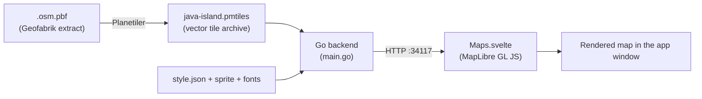

# Offline Map Guide (for junior developers)

This document explains how the offline map works end-to-end, which files are
involved, which functions do what, and how to change/update it. No internet
connection is needed at runtime — everything the map needs is stored on disk
under [`maps/`](../maps).

---

## 1. The big picture



There are two completely separate phases:

1. **Data preparation (offline, done once per region / whenever you want to
   refresh the map)** — a `.osm.pbf` file (raw OpenStreetMap data) is
   converted into a `.pmtiles` file (a single-file vector tile archive) using
   a tool called **Planetiler**. This is a slow, one-off step (took ~19
   minutes for Java island) and is **not** run every time the app starts.
2. **Serving + rendering (every time the app runs)** — the Go backend serves
   the pre-built `.pmtiles`, `style.json`, sprite images, and font glyphs
   over plain HTTP on `localhost:34117`. The Svelte frontend
   ([`Maps.svelte`](../frontend/src/lib/components/Maps.svelte)) fetches
   those files and hands them to **MapLibre GL JS**, which draws the map.

---

## 2. Where everything lives

```
maps/
  java-island.osm.pbf   Raw OpenStreetMap extract (input, from Geofabrik)
  planetiler.jar        The conversion tool (Java). Keep this — you'll need
                         it again to convert a different region or refresh data.
  java-island.pmtiles   The converted vector tile archive (output, ~500MB)
  style.json            Describes HOW to draw the data (colors, layers, fonts)
  sprite/               Icon images used by the style (sprite.png/json, @2x)
  fonts/                Text glyphs (pre-rendered letters) for map labels
  data/sources/         Auxiliary datasets Planetiler downloads and caches
                         (water polygons, natural earth, lake centerlines).
                         Reused automatically for future conversions.
```

Code files involved:

| File | Role |
|---|---|
| [`main.go`](../main.go) | Go backend: serves the `maps/` folder over HTTP |
| [`frontend/src/lib/components/Maps.svelte`](../frontend/src/lib/components/Maps.svelte) | Loads the style and renders the MapLibre map |
| [`frontend/vite.config.ts`](../frontend/vite.config.ts) | Frontend dev server config (no map-specific proxy needed anymore) |
| [`maps/style.json`](../maps/style.json) | The "paint by numbers" instructions for the map |

---

## 3. How to change the way the map *looks*

All visual styling lives in **[`maps/style.json`](../maps/style.json)**. This
file is just static JSON served straight from disk by the Go backend — you
**do not need to rebuild the Go app** to see style changes. Just:

1. Edit `maps/style.json`.
2. Reload the app window (Cmd+R in the webview, or restart `wails dev`).

Because [`Maps.svelte`](../frontend/src/lib/components/Maps.svelte) calls
`fetch()` on `style.json` fresh every time the map component mounts (see
`loadOfflineStyle()` below), your edits show up immediately on reload.

### 3.1 Structure of `style.json`

```jsonc
{
  "version": 8,
  "sources": {
    "openmaptiles": {
      "type": "vector",
      "url": "pmtiles:///maps/java-island.pmtiles"   // <- points at the data file
    }
  },
  "sprite": "/maps/sprite/sprite",                     // <- icon sheet (no extension)
  "glyphs": "/maps/fonts/{fontstack}/{range}.pbf",      // <- text glyphs template
  "layers": [
    { "id": "water", "type": "fill", "source": "openmaptiles",
      "source-layer": "water", "paint": { "fill-color": "#aad3df" } },
    { "id": "building", "type": "fill", "source": "openmaptiles",
      "source-layer": "building", "paint": { "fill-color": "#d9d0c9" } },
    ...
  ]
}
```

Key things to know as a junior dev:

- **`layers` is an array, and order matters.** MapLibre draws them from
  first to last, like stacking sheets of paper — a layer later in the array
  is drawn *on top of* one earlier in the array. If you want roads to be
  visible above land color, `landcover` layers must come before `road`
  layers in the array.
- **`source-layer`** tells MapLibre which "layer" of data *inside* the
  `.pmtiles` archive to use. This name comes from the OpenMapTiles schema
  (the schema Planetiler used to build the tiles) — it does **not** come
  from `style.json` itself, it's baked into the `.pmtiles` file. Common
  ones you'll see: `water`, `waterway`, `landcover`, `landuse`, `park`,
  `building`, `transportation` (roads), `transportation_name` (road
  labels), `boundary` (admin borders), `place` (city/town names), `poi`
  (points of interest), `aeroway` (airports).
- **`paint`** controls colors/widths/opacity (e.g. `"fill-color"`,
  `"line-width"`). **`layout`** controls visibility/text/icon placement
  (e.g. `"text-field"`, `"icon-image"`, `"visibility"`).
- **`minzoom` / `maxzoom`** on a layer control at which zoom levels it's
  drawn (e.g. small roads only show up once you zoom in close).

### 3.2 Example: change water color

Find the layer with `"id": "water"` (or similar, e.g. `"water-offset"`) and
change its `fill-color`:

```jsonc
{ "id": "water", "type": "fill", "source": "openmaptiles",
  "source-layer": "water", "paint": { "fill-color": "#3a86ff" } }
```

### 3.3 Example: hide a layer

Add `"layout": { "visibility": "none" }` to any layer object to hide it
without deleting it (useful for temporarily turning off POI icons, etc).

### 3.4 Example: change the initial map position/zoom

That's not in `style.json` — it's set in
[`Maps.svelte`](../frontend/src/lib/components/Maps.svelte) inside the
`maplib.Map({...})` constructor:

```ts
map = new maplib.Map({
  container: mapContainer,
  style,
  center: [110.44058375436, -7.777392115], // [longitude, latitude]
  zoom: 8,
});
```

---

## 4. How to convert a *new* region, or refresh the data

This is the slow, occasional step. Do this whenever you want map data for a
different area, or an updated extract of the same area.

### 4.1 Prerequisites

- **Java 21+** is required by Planetiler (an older Java gives an
  `UnsupportedClassVersionError`). On this machine it's installed at
  `/opt/homebrew/opt/openjdk@21/bin/java` (installed via
  `brew install openjdk@21`, kept separate from the system default Java).
- `maps/planetiler.jar` — the conversion tool. Already downloaded; if it's
  ever missing, re-download it:
  ```sh
  curl -L -o maps/planetiler.jar \
    https://github.com/onthegomap/planetiler/releases/latest/download/planetiler.jar
  ```

### 4.2 Get a `.osm.pbf` extract

Download a region extract from [Geofabrik](https://download.geofabrik.de/)
(pick the smallest region that covers what you need — smaller extracts
convert much faster and produce smaller `.pmtiles` files). Place it under
`maps/`, e.g. `maps/sumatra.osm.pbf`.

### 4.3 Run Planetiler

```sh
/opt/homebrew/opt/openjdk@21/bin/java -Xmx4g -jar \
  /Users/aji-c/Files/scm/2026/drone-detect-jamm-AC-lite/desktopui-drn-detect-jamm-lite/maps/planetiler.jar \
  --download \
  --osm-path=/Users/aji-c/Files/scm/2026/drone-detect-jamm-AC-lite/desktopui-drn-detect-jamm-lite/maps/sumatra.osm.pbf \
  --output=/Users/aji-c/Files/scm/2026/drone-detect-jamm-AC-lite/desktopui-drn-detect-jamm-lite/maps/sumatra.pmtiles
```

Notes:
- Use **absolute paths** for `--osm-path`/`--output`/the jar — relying on
  `cd` before the command has been unreliable in some terminal setups.
- `--download` fetches shared auxiliary datasets (water polygons, natural
  earth, lake centerlines, a few hundred MB total) into `maps/data/sources/`
  the first time. It's cached there and reused for future conversions, so
  you only need `--download` again if that cache is deleted.
- `-Xmx4g` gives Planetiler 4GB of heap. Increase it if you convert a much
  bigger region and it runs out of memory.
- This can take anywhere from a few minutes to a long time depending on
  region size. Let it run to completion — **don't** send other commands to
  the same terminal session while it's running, or you risk interrupting it.

### 4.4 Point the app at the new file

Edit `maps/style.json` and change the source URL:

```jsonc
"sources": {
  "openmaptiles": {
    "type": "vector",
    "url": "pmtiles:///maps/sumatra.pmtiles"
  }
}
```

Also update the `center`/`zoom` in
[`Maps.svelte`](../frontend/src/lib/components/Maps.svelte) if the new
region is somewhere else on the globe. Reload the app to see it.

---

## 5. Code walkthrough (function by function)

### 5.1 [`main.go`](../main.go) — the Go backend

```go
func mapsDir() string
```
Figures out the absolute path to the `maps/` folder at runtime. It checks
next to the compiled executable first (for packaged/installed builds on
Windows/Linux, and inside the `.app/Contents/Resources/` folder on macOS),
and falls back to the relative `"maps"` folder for local development
(`wails dev`).

```go
func mapsHandler() http.Handler
```
Builds a standard Go `http.Handler` that serves files straight off disk
from whatever `mapsDir()` returns, using `http.FileServer` (which natively
supports HTTP Range requests — required because the `.pmtiles` protocol
reads chunks of the big archive file rather than downloading it all at
once). It strips the `/maps/` prefix from incoming request paths first
(e.g. a request for `/maps/style.json` is served from `<mapsDir>/style.json`).

```go
func mapsHandlerCORS() http.Handler
```
Wraps `mapsHandler()` and adds an `Access-Control-Allow-Origin: *` header.
This is needed because the frontend page and this map server run on
**different ports** (see §5.3 below on why), which browsers treat as
different origins — without this header, the browser blocks the `fetch()`
calls as a CORS violation.

```go
func main()
```
Starts a **second, independent HTTP server** in a background goroutine,
listening on `localhost:34117`, serving `mapsHandlerCORS()`. This runs
alongside (not instead of) the normal Wails app window. It's kept separate
from Wails' main `AssetServer` because in `wails dev` mode, Wails proxies
most requests to the Vite dev server rather than reliably invoking a custom
`Handler` — see the "Gotchas" section below for why this matters.

### 5.2 [`frontend/src/lib/components/Maps.svelte`](../frontend/src/lib/components/Maps.svelte)

```ts
const protocol = new Protocol();
maplib.addProtocol("pmtiles", protocol.tile);
```
Teaches MapLibre GL JS how to understand `pmtiles://...` URLs — i.e. how to
read vector tiles directly out of a single `.pmtiles` file via HTTP Range
requests, instead of requesting one file per tile from a traditional tile
server. This only needs to run once when the module loads.

```ts
const MAPS_ORIGIN = "http://localhost:34117";
```
The address of the dedicated Go map server from §5.1. Everything the map
needs (`style.json`, the `.pmtiles` file, sprite, fonts) is fetched from
this origin.

```ts
async function loadOfflineStyle(): Promise<maplib.StyleSpecification>
```
1. Fetches `maps/style.json` as JSON (not just a URL string) so we can edit
   it in JavaScript before use.
2. Rewrites `style.sprite`, `style.glyphs`, and the vector source's `url`
   field to be **absolute** URLs prefixed with `MAPS_ORIGIN`. This is
   required because MapLibre GL JS rejects root-relative paths (like
   `/maps/sprite/sprite`) for these three fields — they must be full,
   absolute URLs.
3. Returns the modified style object.

```ts
$effect(() => { ... });
```
Svelte 5's reactive effect. Runs whenever `mapContainer` (the `<div>` the
map renders into) becomes available. It calls `loadOfflineStyle()`, then
constructs the `maplib.Map` instance once the style is ready, and adds
navigation controls (zoom buttons/compass). The cleanup function (returned
from the effect) calls `map.remove()` so the map is properly destroyed if
the component is ever unmounted.

### 5.3 Why the dedicated port instead of Wails' own asset server?

Wails already runs an HTTP-ish asset server (default `localhost:34115`)
that serves the frontend app. It has an `AssetServer.Handler` option that
*sounds* like it should let us plug in `mapsHandler()` there directly and
serve `/maps/*` on the same port/origin as the rest of the app. This was
tried first — but in `wails dev` mode, Wails proxies most/all unmatched
requests straight to the Vite dev server instead of consulting the custom
`Handler`, so `/maps/*` requests never reached our Go code (they got
`index.html` back instead of real files, or ended up in an infinite
proxy loop if we also added a matching Vite proxy rule — see §6). Running
a small second server on its own fixed port sidesteps that ambiguity
entirely and behaves identically in dev and in packaged builds.

---

## 6. Gotchas learned the hard way (don't repeat these)

- **Don't add a Vite `server.proxy` rule that forwards `/maps` back to the
  Wails dev port (34115).** Wails already forwards unmatched requests to
  Vite, so proxying it back creates an infinite loop between the two dev
  servers, and requests fail with `431 Request Header Fields Too Large`.
- **MapLibre needs absolute URLs** for `sprite`, `glyphs`, and vector
  source `url` fields — root-relative paths (`/maps/...`) cause errors like
  `Invalid sprite URL, must be absolute` or, worse, a silent wrong-file
  fetch that results in `Wrong magic number for PMTiles archive` (because
  the request resolved to the app's `index.html` instead of the real
  `.pmtiles` file).
- **Planetiler needs Java 21+.** An older Java (e.g. 17) fails with
  `UnsupportedClassVersionError`.
- **Use `--download`** the first time you run Planetiler for a region, so
  it fetches the shared auxiliary datasets it needs. Omitting it fails with
  a "file does not exist, run with --download" error.
- **Use absolute paths** for all Planetiler command arguments (jar path,
  `--osm-path`, `--output`) rather than `cd`-ing into a directory first.
- **Never interrupt a long-running Planetiler/download command** in the
  same terminal session by sending it another command — that can send an
  interrupt signal and kill hours of downloading/processing.
