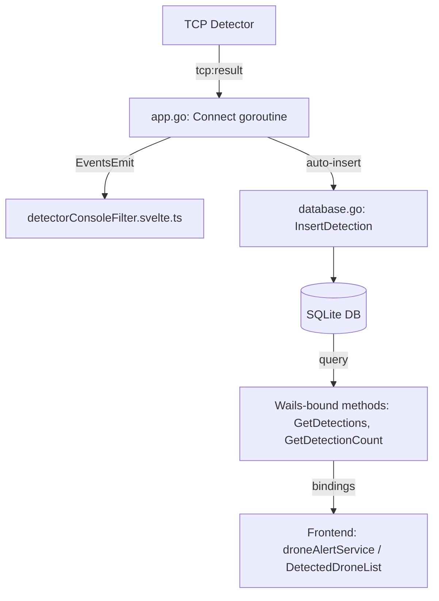

# SQLite Drone Detection Persistence Plan

## Overview
Add Go-side SQLite (via `modernc.org/sqlite` — pure Go, no CGO) to persist drone detection events. The Go backend auto-inserts on every `tcp:result` event with a deduplication filter, and exposes query methods the frontend can call via Wails bindings.

## Architecture



## Database Schema

```sql
CREATE TABLE IF NOT EXISTS detections (
    id          INTEGER PRIMARY KEY AUTOINCREMENT,
    timestamp   INTEGER NOT NULL,          -- Unix milliseconds
    serial_number TEXT NOT NULL DEFAULT '',
    model       TEXT NOT NULL DEFAULT '',
    latitude    REAL NOT NULL DEFAULT 0.0,
    longitude   REAL NOT NULL DEFAULT 0.0,
    scan_freq_mhz REAL NOT NULL DEFAULT 0.0,
    drone_range REAL NOT NULL DEFAULT 0.0,
    altitude    REAL NOT NULL DEFAULT 0.0
);

CREATE INDEX IF NOT EXISTS idx_detections_serial_ts
    ON detections(serial_number, timestamp DESC);
```

## Deduplication Logic

Before inserting, query the most recent `timestamp` for the same `serial_number`. If the difference is < 30,000 ms (30 seconds), skip the insert. Different serial numbers are always inserted regardless of timing.

```go
func (db *DetectionDB) InsertDetection(payload ResultPayload) error {
    // Check last timestamp for this serial number
    lastTs, err := db.lastDetectionTs(payload.SerialNumber)
    if err == nil && (payload.Timestamp - lastTs) < 30_000 {
        return nil // skip — same drone within 30s window
    }
    // Insert new row
    ...
}
```

## Auto-Delete Old Data

A background goroutine runs on startup and then every 24 hours to delete records older than the retention period. The retention is **6 months** by default, stored as a constant that can be easily changed.

```go
const retentionDuration = 180 * 24 * time.Hour // 6 months

func (db *DetectionDB) startAutoCleanup(ctx context.Context) {
    db.purgeOld() // run immediately on startup
    ticker := time.NewTicker(24 * time.Hour)
    go func() {
        for {
            select {
            case <-ticker.C:
                db.purgeOld()
            case <-ctx.Done():
                ticker.Stop()
                return
            }
        }
    }()
}

func (db *DetectionDB) purgeOld() {
    cutoff := time.Now().Add(-retentionDuration).UnixMilli()
    _, err := db.sql.Exec("DELETE FROM detections WHERE timestamp < ?", cutoff)
    // log if error
}
```

This keeps the DB lean without any manual intervention. The 6-month constant can be changed to 12 months (365 days) if you later decide you need a full year.

## Files to Create / Modify

### 1. `database.go` (NEW)
- `DetectionDB` struct holding `*sql.DB`
- `Open(dbPath string) (*DetectionDB, error)` — opens/creates DB, runs schema migration
- `Close() error`
- `InsertDetection(payload ResultPayload) error` — with dedup filter
- `GetDetections(limit, offset int) ([]Detection, error)` — paginated query
- `GetDetectionCount() (int, error)` — total row count
- `lastDetectionTs(serialNumber string) (int64, error)` — helper for dedup
- `startAutoCleanup(ctx context.Context)` — background goroutine that purges old records daily
- `purgeOld()` — deletes records older than 6 months

### 2. `app.go` (MODIFY)
- Add `db *DetectionDB` field to `App` struct
- In `startup()`: open DB at `{configDir}/detections.db`, call `a.db.startAutoCleanup(a.ctx)`
- In the `Connect()` goroutine, after `parseTCPLine` succeeds for `"result"`: call `a.db.InsertDetection(payload)` (non-blocking, log errors)
- In `shutdown()`: close DB
- Add bound methods: `GetDetections(limit, offset int) ([]Detection, error)`, `GetDetectionCount() (int, error)`

### 3. `go.mod` (MODIFY)
- Add `modernc.org/sqlite` dependency

### 4. Frontend bindings (REGENERATE)
- Run `wails generate module` to produce updated `frontend/wailsjs/go/main/App.js` and `App.d.ts`

### 5. `frontend/src/lib/stores/droneAlertService.svelte.ts` (MODIFY - optional)
- Optionally call `GetDetections` on startup to pre-populate recent history

### 6. `frontend/src/lib/components/DetectedDroneList.svelte` (MODIFY - optional)
- Optionally add a "History" tab or section to view past detections

## Data Flow

1. TCP line arrives → `parseTCPLine` → `ResultPayload`
2. `runtime.EventsEmit("tcp:result", payload)` — existing frontend path unchanged
3. **NEW**: `a.db.InsertDetection(payload)` — fire-and-forget goroutine
4. Dedup check: query last timestamp for serial number → skip if < 30s
5. Insert row into `detections` table
6. Frontend can call `GetDetections(limit, offset)` anytime to retrieve history

## DB File Location

```
{os.UserConfigDir()}/Anti Drone System/detections.db
```

Same directory as `config.json`, keeping all app data together.

## Todo List

- [ ] Add `modernc.org/sqlite` to `go.mod` (`go get modernc.org/sqlite`)
- [ ] Create `database.go` with DetectionDB struct, schema, insert (with dedup), auto-cleanup, and query methods
- [ ] Modify `app.go`: add `db` field, init in `startup()` + start auto-cleanup, auto-insert in Connect goroutine, close in `shutdown()`
- [ ] Add Wails-bound methods: `GetDetections`, `GetDetectionCount`
- [ ] Regenerate Wails frontend bindings (`wails generate module`)
- [ ] Update `droneAlertService.svelte.ts` to optionally load recent history on startup
- [ ] Update `DetectedDroneList.svelte` to optionally show historical data